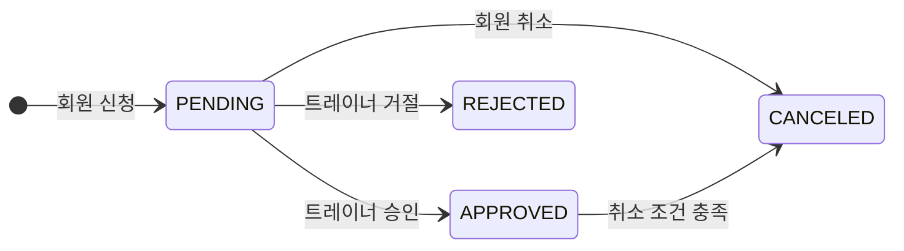
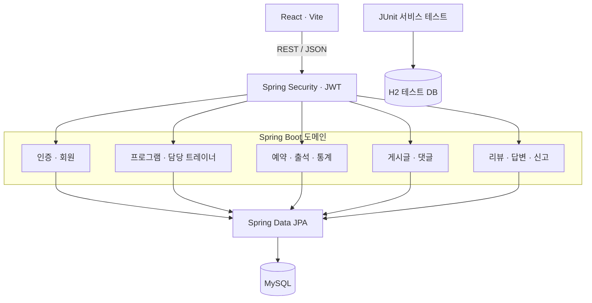
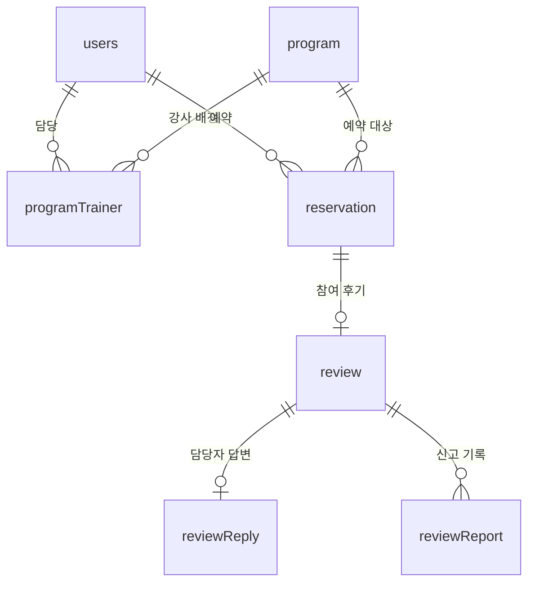

<div align="center">


<br>

**수업을 찾고 예약하는 회원과, 프로그램을 운영하는 트레이너를 연결합니다.**

프로그램 개설 → 예약 신청 → 승인·거절 → 출석 → 리뷰


교육 과정 미니 프로젝트 · 3인 팀 · 백엔드 / 프론트엔드 통합

[소개](#프로젝트-소개) · [예약 화면](#회원의-수업-예약) · [트레이너 화면](#트레이너의-수업-운영) · [리뷰·커뮤니티](#리뷰와-커뮤니티) · [핵심 설계](#핵심-설계) · [아키텍처](#시스템-아키텍처) · [도메인 관계](#주요-도메인-관계) · [API](#주요-api) · [팀](#팀-구성과-협업) · [실행](#실행-방법)

</div>

<br>

## 프로젝트 소개

**Fitness Reserve**는 운동 프로그램의 개설부터 예약, 출석, 후기까지 이어지는 피트니스 예약 서비스입니다.

회원에게는 수업을 찾고 참여하는 흐름을, 트레이너에게는 신청자와 수업을 관리하는 흐름을 제공합니다. 관리자는 회원의 역할과 신고된 리뷰를 관리합니다.

| 회원 | 트레이너 | 관리자 |
| :---: | :---: | :---: |
| **내 운동 일정 관리** | **수업과 참여자 관리** | **회원과 리뷰 관리** |
| 프로그램 탐색 · 예약 신청 | 프로그램 개설 · 담당자 배정 | 회원 조회 · 역할 변경 |
| 내 예약 확인 · 취소 | 예약 승인·거절 · 출석 처리 | 신고된 리뷰 심사 |
| 수업 리뷰 · 커뮤니티 | 리뷰 답변 · 운영 현황 확인 | 리뷰 노출 관리 |

### 구현에서 중요하게 본 문제

| 문제 | 구현 방향 |
| --- | --- |
| 같은 수업에 중복 신청하거나 정원이 찬 수업을 예약 | 활성 예약 존재 여부와 승인 인원 기준 정원 확인 |
| 트레이너 역할만 있으면 다른 수업까지 관리할 위험 | 역할 확인에 더해 해당 프로그램 담당 관계 검증 |
| 예약 승인과 실제 출석이 혼동됨 | 예약 상태와 출석 상태를 별도로 관리 |
| 미처리 예약이 남은 채 수업을 완료 | 대기 예약을 승인·거절한 뒤 완료하도록 제한 |
| 참여하지 않은 수업의 리뷰 또는 예약당 중복 리뷰 | 예약자 본인·출석 여부와 기존 리뷰 확인 |

## 회원의 수업 예약

### 1. 프로그램을 찾고 수업 정보를 확인

모집 중·마감·완료·폐강 상태별로 수업을 탐색합니다. 상세 화면에서 수업 일정, 담당 트레이너, 정원과 리뷰를 확인하고 예약합니다.

<table>
<tr>
<th width="50%">프로그램 탐색</th>
<th width="50%">수업 상세와 예약 신청</th>
</tr>
<tr>
<td valign="top"></td>
<td valign="top"></td>
</tr>
<tr>
<td align="center">그룹 수업과 1:1 PT 목록 · 상태별 필터</td>
<td align="center">일정·담당자·정원 확인 후 예약</td>
</tr>
</table>

### 2. 신청 후 내 예약에서 진행 상태 확인

신청은 즉시 확정되지 않고 **승인 대기**로 시작합니다. 회원은 내 예약에서 승인 대기, 이용 예정, 이용 완료, 취소·거절 내역을 구분해 확인합니다.

<table>
<tr>
<th width="50%">예약 신청 완료</th>
<th width="50%">내 예약</th>
</tr>
<tr>
<td valign="top"></td>
<td valign="top"></td>
</tr>
<tr>
<td align="center">신청 성공 안내와 승인 대기 상태</td>
<td align="center">예약 상태·수업 일정·출석·리뷰 연결</td>
</tr>
</table>

| 회원 행동 | 서버에서 확인하는 조건 |
| --- | --- |
| 예약 신청 | 프로그램이 모집 중인지, 대기·승인 상태의 중복 예약이 있는지, 승인 인원 기준 정원이 남았는지 |
| 예약 취소 | 본인 예약인지, 대기·승인 상태인지, 수업 완료 또는 출석 처리가 끝난 예약인지 |
| 리뷰 작성 | 본인의 예약인지, 출석 상태인지, 작성 기간과 기존 리뷰 조건을 만족하는지 |

## 트레이너의 수업 운영

### 1. 담당 수업과 신청 현황 확인

트레이너는 담당 프로그램별 전체 예약, 승인 대기, 승인 인원을 확인합니다. 대표 담당자는 수업 정보를 수정하고 보조 트레이너를 배정하거나 수업 상태를 변경합니다.

<table>
<tr>
<th width="50%">담당 수업 현황</th>
<th width="50%">프로그램 운영</th>
</tr>
<tr>
<td valign="top"></td>
<td valign="top"></td>
</tr>
<tr>
<td align="center">담당 수업과 예약 인원 확인</td>
<td align="center">대표 담당자의 수업 상태·강사 관리</td>
</tr>
</table>

### 2. 예약 승인부터 출석까지

모집 중인 수업에서는 대기 예약을 승인·거절하고, 수업이 완료 상태가 되면 승인된 예약의 출석·결석을 처리합니다.

<table>
<tr>
<th width="50%">예약 승인·거절</th>
<th width="50%">완료 수업의 출석 관리</th>
</tr>
<tr>
<td valign="top"></td>
<td valign="top"></td>
</tr>
<tr>
<td align="center">신청자와 예약 상태를 확인해 처리</td>
<td align="center">수업 완료 후 출석·결석 처리</td>
</tr>
</table>

| 운영 작업 | 권한과 규칙 |
| --- | --- |
| 프로그램 생성 | 트레이너 역할 확인, 생성자를 대표 담당자로 배정 |
| 수업 수정·폐강·완료 | 해당 프로그램의 대표 담당자 확인 |
| 보조 강사 추가 | 대표 담당자가 요청하고, 대상자의 트레이너 역할 및 중복 배정 확인 |
| 예약 승인·거절 | 해당 프로그램 담당자 확인, 대기 예약 상태 확인 |
| 수업 완료 | 폐강 여부와 미처리 대기 예약 존재 여부 확인 |
| 출석 처리 | 해당 프로그램 담당자, 완료된 수업, 승인된 예약 여부 확인 |

<details>
<summary><b>프로그램 등록 화면</b></summary>


프로그램명, 그룹 수업·1:1 PT 유형, 설명, 정원, 시작·종료 일정을 입력합니다.

</details>

## 리뷰와 커뮤니티

### 참여 기록에 연결되는 리뷰

출석한 회원이 리뷰를 작성하고, 담당 트레이너가 답변합니다. 프로그램과 트레이너별로 리뷰 및 평점 요약을 조회할 수 있습니다.

트레이너의 리뷰 신고는 숨김·관리자 심사 흐름으로 이어집니다. 작성자 삭제와 관리자 삭제를 구분해 재작성과 노출 정책을 관리합니다.

<table>
<tr>
<th width="50%">프로그램·트레이너 리뷰</th>
<th width="50%">회원 커뮤니티</th>
</tr>
<tr>
<td valign="top"></td>
<td valign="top"></td>
</tr>
<tr>
<td align="center">참여 후기·평점·트레이너 답변</td>
<td align="center">질문·공지·검색·정렬·댓글 수</td>
</tr>
</table>

### 게시글과 댓글

회원은 게시글과 댓글로 질문과 경험을 공유합니다. 게시판은 카테고리, 검색, 정렬, 내 글 조회와 페이지네이션을 제공하며, 공지 작성은 관리자 권한으로 제한합니다.

> 화면은 로컬 H2 메모리 DB에 예시 계정·수업·예약·리뷰를 넣어 실제 프론트엔드와 API를 연결해 캡처했습니다. 운영 데이터와 실제 고객 후기가 아닙니다.

<details>
<summary><b>로그인·회원가입 화면</b></summary>

<table>
<tr>
<th width="50%">로그인</th>
<th width="50%">회원가입</th>
</tr>
<tr>
<td valign="top"></td>
<td valign="top"></td>
</tr>
</table>

JWT Access/Refresh Token으로 인증하고, 회원·트레이너·관리자 역할에 따라 이용 기능을 구분합니다.

</details>

## 핵심 설계

### 1. 예약과 출석의 상태 분리

예약의 승인 여부와 실제 수업 참여 여부는 서로 다른 정보입니다. 두 상태를 분리해 승인된 예약, 출석한 예약, 결석한 예약을 구분했습니다.



| 상태 구분 | 값 | 의미 |
| --- | --- | --- |
| 예약 | `PENDING` / `APPROVED` / `REJECTED` / `CANCELED` | 대기 / 승인 / 거절 / 취소 |
| 출석 | `NOT_CHECKED` / `ATTENDED` / `NO_SHOW` | 미확인 / 출석 / 결석 |
| 프로그램 | `OPEN` / `CLOSED` / `COMPLETED` / `CANCELED` | 모집 중 / 마감 / 완료 / 폐강 |

예약이 승인돼도 출석은 자동 확정되지 않습니다. 프로그램 완료 후 별도로 출석을 처리하고, 출석한 예약을 리뷰에 연결합니다.

### 2. 정원·중복·수업 완료 시점의 검증

예약 신청 시 대기·승인 예약이 이미 있는지 확인하고, 승인된 인원 수를 기준으로 정원을 검사합니다. 승인 시점에도 정원을 다시 확인합니다.

프로그램을 완료할 때 미처리 대기 예약이 있으면 먼저 승인·거절하도록 제한합니다. 완료된 수업에 남은 기존 대기 예약은 거절할 수 있도록 별도 조건을 둡니다.

> 현재 검증은 서비스 계층의 조회와 조건 검사입니다. 동시 신청·승인 상황의 정원 보장은 별도의 동시성 검증과 보강 대상입니다.

### 3. 역할과 실제 담당 관계를 함께 확인

Spring Security는 요청의 인증과 역할별 접근을 제어합니다. 서비스 계층은 본인 예약인지, 해당 수업 담당자인지, 대표 담당자인지를 추가로 확인합니다.

| 확인 위치 | 책임 |
| --- | --- |
| Spring Security · JWT 필터 | 인증 여부와 회원·트레이너·관리자 접근 규칙 |
| 프로그램 서비스 | 대표 담당자의 수업 관리, 보조 강사 배정 조건 |
| 예약 서비스 | 예약자 본인, 담당 트레이너, 예약·출석 상태 |
| 리뷰 서비스 | 작성자 본인, 출석 기록, 담당 트레이너, 리뷰 상태 |

### 4. 리뷰의 재작성과 삭제 정책

예약당 리뷰 한 행을 유지하도록 `reservation_id`에 유일 제약을 둡니다. 사용자가 직접 삭제한 리뷰를 다시 작성하면 새 행을 추가하는 대신 기존 행을 복원·갱신해 유일 제약 충돌을 피합니다.

관리자 삭제, 사용자 삭제, 숨김과 노출 상태를 구분해 수정·재작성·심사 규칙을 적용합니다.

### 5. 목록 조회와 연관 데이터 처리

프로그램 목록은 담당 트레이너를 fetch join으로 함께 조회하고, 일대다 조인으로 생길 수 있는 중복은 `DISTINCT`로 제거합니다.

게시글·댓글·리뷰 조회에서도 연관 정보의 반복 조회를 줄이도록 조회 구조를 보강했습니다. 내 예약에 연결된 리뷰는 예약 ID 목록으로 일괄 조회합니다.

### 6. 운영 통계의 집계 기준

| 통계 | 집계 방식 |
| --- | --- |
| 예약이 없는 프로그램 | 예약 존재 여부를 `NOT EXISTS` 서브쿼리로 확인 |
| 트레이너별 월간 승인 예약 | 대표 담당 관계를 조인하고, 이번 달 생성된 승인 예약을 그룹별 집계 |
| 인기 프로그램 | 승인 예약 수를 프로그램별 집계하고 상위 N개 조회 |

담당 수업 화면의 인원 표시와 서버 통계 API를 구분해 구성했습니다. 월간 통계는 예약 생성일 기준이며 수업 진행 월 기준 통계와는 다릅니다.

## 시스템 아키텍처



백엔드는 도메인별 Controller → Service → Repository 계층으로 구성했습니다. 프론트엔드도 도메인별 화면과 API 모듈을 분리해 작업 범위를 맞췄습니다.

## 주요 도메인 관계

예약과 리뷰를 중심으로 정리한 관계입니다. 인증·역할과 커뮤니티를 포함한 전체 테이블 정의는 [DB 스키마](https://github.com/superparkgit/minipro_06/blob/main/docs/db/schema.sql)를 참고합니다.



| 관계 | 설계 의도 |
| --- | --- |
| 프로그램 ↔ 트레이너 | 담당 관계 엔티티에 대표·보조 역할을 저장 |
| 회원 ↔ 프로그램 예약 | 신청 상태와 출석 상태를 예약에 저장 |
| 예약 ↔ 리뷰 | 예약당 하나의 리뷰 행과 참여 자격 연결 |
| 리뷰 ↔ 답변·신고 | 후기 작성과 트레이너·관리자의 후속 처리를 분리 |

## 주요 API

<details>
<summary><b>프로그램·예약·출석·리뷰 API 펼치기</b></summary>

| 영역 | Method | 경로 | 설명 |
| --- | --- | --- | --- |
| 프로그램 | GET | `/api/programs` | 프로그램 목록, 유형·날짜 필터 |
| 프로그램 | POST | `/api/programs` | 프로그램 등록 |
| 프로그램 | GET | `/api/programs/{id}` | 프로그램 상세 |
| 프로그램 | PATCH | `/api/programs/{id}` | 프로그램 수정 |
| 프로그램 | PATCH | `/api/programs/{id}/complete` | 수업 완료 |
| 프로그램 | POST | `/api/programs/{id}/trainers` | 보조 트레이너 배정 |
| 예약 | POST | `/api/reservations` | 예약 신청 |
| 예약 | GET | `/api/reservations/me` | 내 예약 조회 |
| 예약 | PATCH | `/api/reservations/{id}/cancel` | 예약 취소 |
| 예약 | GET | `/api/programs/{id}/reservations` | 수업별 예약자 조회 |
| 예약 | PATCH | `/api/reservations/{id}/approve` | 예약 승인 |
| 예약 | PATCH | `/api/reservations/{id}/reject` | 예약 거절 |
| 출석 | PATCH | `/api/reservations/{id}/attendance` | 출석·결석 처리 |
| 통계 | GET | `/api/stats/trainers/monthly` | 트레이너별 월간 승인 예약 |
| 통계 | GET | `/api/stats/programs/popular` | 인기 프로그램 |
| 리뷰 | POST | `/api/reservations/{reservationId}/reviews` | 예약 기반 리뷰 작성 |
| 리뷰 | GET | `/api/programs/{programId}/reviews` | 프로그램 리뷰 |
| 리뷰 | POST | `/api/reviews/{reviewId}/replies` | 담당 트레이너 답변 |
| 리뷰 | POST | `/api/reviews/{reviewId}/reports` | 리뷰 신고 |
| 관리자 | PATCH | `/api/admin/reviews/{reviewId}/decision` | 리뷰 신고 심사 |

전체 응답 필드와 상세 검증 조건은 각 도메인의 Controller·DTO·Service에서 확인할 수 있습니다.

</details>

## 기술 스택

| 영역 | 사용 기술 |
| --- | --- |
| Backend | Java 21 · Spring Boot 4.1 · Spring MVC · Spring Data JPA |
| Authentication | Spring Security · JWT · jjwt |
| Frontend | React 19 · Vite 8 · React Router · Axios |
| Database | MySQL · H2(테스트·로컬 캡처) |
| Test | JUnit · Spring Security Test |
| Collaboration | Git · GitHub · 기능별 브랜치 · Pull Request |

## 팀 구성과 협업

각 담당자는 도메인의 API와 프론트엔드 화면, 서비스 테스트를 함께 구현했습니다.

| 팀원 | 담당 영역 | 주요 기여 |
| --- | --- | --- |
| **창민** · [H0ng](https://github.com/H0ng) | 인증 · 회원 · 관리자 | JWT·토큰 재발급·로그아웃, 역할 관리, 공통 예외·접근 제어, 인증·관리자 화면과 테스트 |
| **박서희** · [superparkgit](https://github.com/superparkgit) | 프로그램 · 예약 | 프로그램·담당 트레이너, 예약·출석·통계, 관련 화면·테스트, 프론트 공통 구조·담당별 작업 분리와 연동 보완 |
| **용재** · [YJ720](https://github.com/YJ720) | 커뮤니티 · 리뷰 | 게시글·댓글, 리뷰·답변·신고·심사·평점, N+1 개선, 관련 화면과 테스트 |

- 기능별 브랜치와 Pull Request로 각 도메인의 작업을 통합했습니다.
- 공통 Security 설정, 예외 응답, 도메인 간 API 계약을 함께 조정했습니다.
- 라우팅·레이아웃·API 모듈의 담당 범위를 문서화해 충돌 범위를 줄였습니다.
- 예약 화면의 리뷰 연결, 계정 전환 시 권한 갱신, 상태별 버튼 노출을 보완했습니다.

## 프로젝트 구조

```text
minipro_06/
├── src/main/java/com/mycom/myapp/domain/
│   ├── auth/           # 로그인·토큰
│   ├── security/       # 인증 필터·접근 제어
│   ├── user/           # 회원·역할
│   ├── program/        # 수업·담당 트레이너
│   ├── reservation/    # 예약·출석·통계
│   ├── post/           # 게시글
│   ├── comment/        # 댓글
│   └── review/         # 리뷰·답변·신고
├── src/test/           # 서비스 테스트·테스트 설정
├── frontend/src/
│   ├── api/            # 도메인별 API 모듈
│   ├── auth/           # 브라우저 인증 상태
│   ├── pages/          # 도메인별 화면
│   ├── routes/         # 라우팅
│   └── components/     # 공통 UI
└── docs/db/            # 스키마·예시 데이터
```

## 실행 방법

<details>
<summary><b>로컬 실행 안내 펼치기</b></summary>

### 사전 준비

- JDK 21
- Vite 8이 지원하는 Node.js 환경
- MySQL

```bash
git clone https://github.com/superparkgit/minipro_06.git
cd minipro_06
```

MySQL에 데이터베이스를 생성합니다.

```sql
CREATE DATABASE jpa_fitness;
```

### 백엔드

로컬 접속 정보와 JWT 서명 키를 환경변수로 설정합니다.

```bash
export SPRING_DATASOURCE_URL='jdbc:mysql://localhost:3306/jpa_fitness'
export SPRING_DATASOURCE_USERNAME='your-local-db-user'
export SPRING_DATASOURCE_PASSWORD='your-local-db-password'
export JWT_SECRET='replace-with-a-random-secret-at-least-32-bytes-long'

./gradlew bootRun
```

기본 API 주소는 `http://localhost:8080`입니다. 실제 비밀번호와 서명 키는 저장소에 커밋하지 않습니다.

### 프론트엔드

별도 터미널에서 저장소의 `frontend` 디렉터리로 이동합니다.

```bash
cd frontend
cp .env.example .env
npm ci
npm run dev
```

개발 서버 주소는 터미널 출력을 확인합니다. API 연결 주소는 `.env.example`과 Vite 설정을 참고합니다.

### 예시 데이터 사용 시

`docs/db/schema.sql`과 `docs/db/data.sql`은 개발용 참고 자료입니다. 특히 `data.sql`은 기존 데이터를 삭제하는 구문을 포함하므로 **데이터가 없는 전용 로컬 DB에서만** 사용합니다.

README 화면 캡처는 별도의 H2 메모리 DB와 예시 데이터를 사용했습니다. 이 캡처 환경 설정은 기본 MySQL 실행 설정과 다릅니다.

</details>

## 테스트와 검증 범위

### 테스트 명령

| 구분 | 실행 위치 | 명령 |
| --- | --- | --- |
| 백엔드 테스트 | 저장소 루트 | `./gradlew test` |
| 프론트엔드 정적 검사 | `frontend` | `npm run lint` |
| 프론트엔드 빌드 | `frontend` | `npm run build` |

백엔드 테스트는 H2와 테스트 전용 설정을 사용합니다.

| 테스트 영역 | 메서드 선언 수 | 주요 대상 |
| --- | ---: | --- |
| 인증·회원·관리자 | 12 | 로그인·가입·토큰·회원·관리자 서비스 |
| 프로그램·예약 | 37 | 수업·담당자·신청·취소·승인·출석 |
| 게시글·댓글·리뷰 | 72 | 글·댓글·후기·답변·신고·평점 |
| 공통 | 1 | 애플리케이션 컨텍스트 |
| **합계** | **122** | 현재 코드의 테스트 선언 기준 |

테스트 수는 메서드 선언 개수이며 통과 수나 커버리지 수치가 아닙니다.

### 이번 문서의 화면·연동 확인

| 확인 단계 | 범위 |
| --- | --- |
| **화면 검증** | 예시 데이터로 프로그램 목록·상세·내 예약·트레이너 관리·출석·리뷰·커뮤니티 캡처 |
| **실제 로컬 연동 확인** | 회원 로그인과 예약 신청은 브라우저에서, 승인·수업 완료·출석·리뷰 작성은 실제 API로 확인 |
| **실행 조건** | 로컬 H2 메모리 DB, 합성 계정과 예시 데이터, API 대역 없음 |
| **미검증** | 이번 문서 작업에서 전체 자동 테스트 재실행, 운영 MySQL 동시성·부하·배포 검증 |

## 개선 방향

- 동시 신청·승인 상황의 정원 보장과 경합 테스트
- Controller 계층 및 통합 테스트 확대
- API 명세와 운영 환경별 설정 정리
- Docker Compose 기반 로컬 실행 환경과 배포 자동화
- Refresh Token 저장 정책과 브라우저 토큰 보관 방식 보강

## 관련 문서

| 문서 | 내용 |
| --- | --- |
| [프론트엔드 담당 범위](https://github.com/superparkgit/minipro_06/blob/main/frontend/TEAM_WORK.md) | 도메인별 작업 영역 |
| [프론트엔드 협업 규칙](https://github.com/superparkgit/minipro_06/blob/main/frontend/TEAM_WORKFLOW.md) | 작업·통합 절차 |
| [DB 스키마](https://github.com/superparkgit/minipro_06/blob/main/docs/db/schema.sql) | 전체 테이블 정의 |

