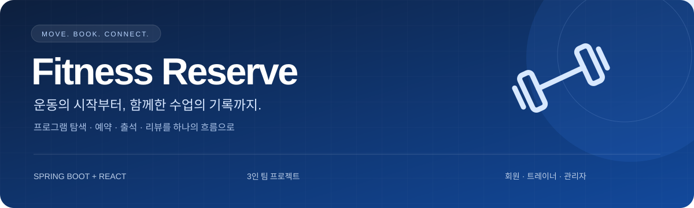
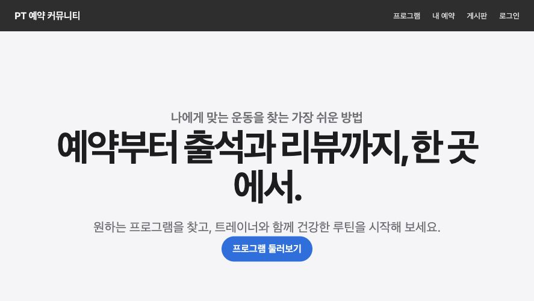
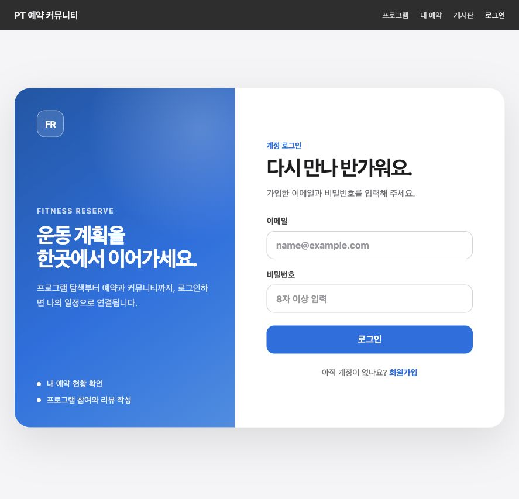
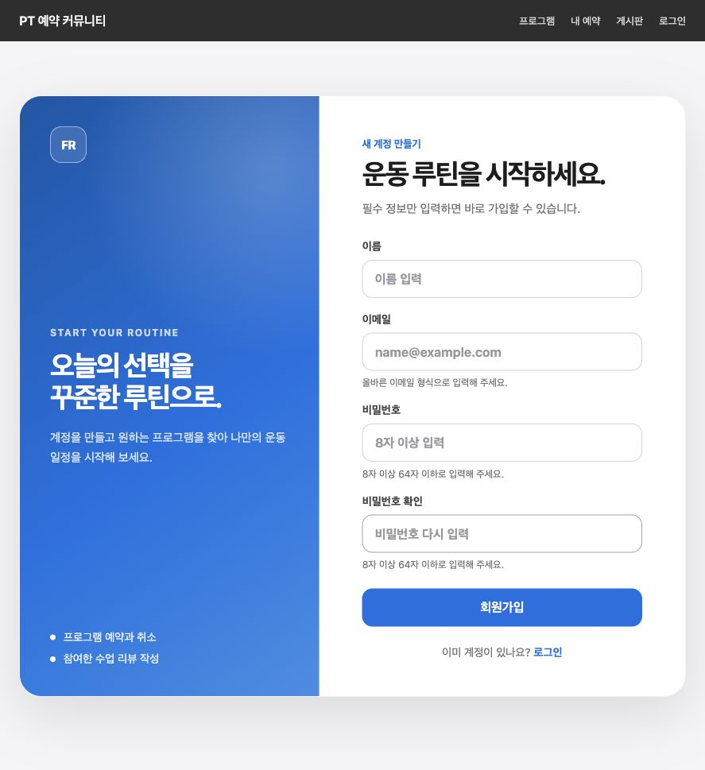

<div align="center">



<br>

**트레이너의 수업 운영과 회원의 운동 경험을 연결하는 피트니스 예약 서비스**

프로그램 개설부터 예약 승인, 출석, 리뷰까지 한곳에서 관리합니다.


교육 과정 미니 프로젝트 · 3인 팀 · 백엔드 / 프론트엔드 통합

[프로젝트 소개](#프로젝트-소개) · [서비스 화면](#서비스-화면) · [주요 기능](#주요-기능) · [핵심 설계](#핵심-설계) · [팀 구성](#팀-구성) · [실행 방법](#실행-방법)

</div>

<br>

## 프로젝트 소개

**Fitness Reserve**는 회원·트레이너·관리자의 역할에 맞춰 운동 프로그램을 운영하는 웹 서비스입니다.

단순한 예약 등록에서 나아가 **프로그램 모집 상태, 수업 정원, 담당 트레이너, 회원의 참여 기록**을 함께 확인하도록 구현했습니다. 회원의 수업 참여는 리뷰로, 트레이너의 수업 운영은 예약 통계로 이어집니다.

| 회원 | 트레이너 | 관리자 |
| :---: | :---: | :---: |
| **나에게 맞는 수업 찾기** | **수업과 참여자 관리하기** | **회원과 리뷰 관리하기** |
| 프로그램 탐색 · 예약 신청 | 프로그램 개설 · 담당자 배정 | 회원 목록 · 역할 변경 |
| 내 예약 확인 · 취소 | 예약 승인·거절 · 출석 처리 | 신고된 리뷰 심사 |
| 수업 리뷰 · 커뮤니티 | 리뷰 답변 · 예약 통계 | 리뷰 노출 관리 |

## 서비스 화면

### 첫 화면



프로그램 탐색으로 이어지는 서비스 진입 화면입니다.

<table>
<tr>
<th width="50%">로그인</th>
<th width="50%">회원가입</th>
</tr>
<tr>
<td valign="top"></td>
<td valign="top"></td>
</tr>
<tr>
<td align="center">이메일과 비밀번호로 로그인</td>
<td align="center">입력 조건을 안내하는 가입 화면</td>
</tr>
</table>

> 저장소의 프론트엔드를 로컬에서 실행해 직접 캡처한 화면입니다. 백엔드 연결 및 로그인·가입 성공 동작을 검증한 자료는 아닙니다.

## 주요 기능

| 영역 | 핵심 기능 | 연결되는 경험 |
| --- | --- | --- |
| **인증·회원** | 회원가입, 로그인, 토큰 재발급, 로그아웃 | 사용자 역할에 맞는 기능 이용 |
| **프로그램** | 프로그램 등록·수정·조회, 주·보조 트레이너 배정 | 수업 탐색부터 운영까지 |
| **예약·출석** | 신청·승인·거절·취소, 출석·결석 처리 | 신청 내역을 실제 참여 기록으로 연결 |
| **운영 통계** | 인기 프로그램, 트레이너별 월간 승인 건수 | 프로그램 운영 현황 확인 |
| **커뮤니티** | 게시글·댓글 작성·수정·삭제, 페이지네이션 | 회원 간 운동 경험 공유 |
| **리뷰·심사** | 수업 리뷰, 트레이너 답변, 신고·관리자 심사, 평점 집계 | 참여 후기와 후속 관리 |

## 핵심 설계

### 역할 확인에서 담당 관계 확인까지

Spring Security와 JWT로 인증 및 역할별 API 접근을 제어합니다. 예약 승인과 출석 처리에서는 트레이너 역할에 더해 **해당 프로그램의 담당자인지**를 확인합니다.

### 예약과 출석을 서로 다른 상태로 관리

| 구분 | 관리하는 상태 | 적용한 규칙 |
| --- | --- | --- |
| **예약** | 대기 · 승인 · 거절 · 취소 | 신청·승인 시 정원 확인, 중복 신청 제한 |
| **출석** | 미확인 · 출석 · 결석 | 종료된 수업의 승인 예약만 출석 처리 |
| **취소** | 대기·승인 예약에서 요청 | 본인 확인, 수업 완료·출석 처리 후 취소 제한 |

예약 상태와 참여 여부를 분리해 **승인된 예약**과 **실제로 출석한 예약**을 구분합니다. 리뷰 작성 시에는 예약자 본인과 참여 기록을 확인합니다.

### 도메인별 책임과 협업 범위 분리

백엔드는 기능별 도메인 안에서 Controller → Service → Repository 계층으로 구성했습니다. 프론트엔드도 같은 도메인 단위로 페이지와 API 모듈을 분리했습니다.

| 계층 | 역할 |
| --- | --- |
| **React · Vite** | 기능별 화면, 인증 상태 관리, API 요청 |
| **Spring Security · JWT** | 요청 인증, 역할 기반 접근 제어 |
| **Controller · Service** | 요청 처리, 담당 관계와 비즈니스 규칙 확인 |
| **Repository · MySQL** | 도메인 데이터 저장과 조회 |
| **H2 · Test** | 백엔드 테스트용 데이터베이스 |

## 기술 스택

| 영역 | 사용 기술 |
| --- | --- |
| **Backend** | Java 21 · Spring Boot 4.1 · Spring MVC · Spring Data JPA |
| **Authentication** | Spring Security · JWT · jjwt |
| **Frontend** | React 19 · Vite 8 · React Router · Axios |
| **Database** | MySQL · H2(테스트) |
| **Test** | JUnit · Spring Security Test |
| **Collaboration** | Git · GitHub · 기능별 브랜치 · Pull Request |

## 팀 구성

**담당 도메인의 API·화면·테스트를 함께 구현했습니다.**

| 팀원 | 담당 도메인 | 주요 구현 |
| --- | --- | --- |
| **창민** · [H0ng](https://github.com/H0ng) | 인증 · 회원 · 관리자 | JWT 인증·토큰 관리, 회원 역할 관리, 공통 예외·접근 제어, 인증·관리자 화면과 테스트 |
| **박서희** · [superparkgit](https://github.com/superparkgit) | 프로그램 · 예약 | 프로그램·담당자 관리, 예약·출석·통계, 관련 화면·테스트, 프론트 공통 구조와 도메인별 작업 분리 |
| **용재** · [YJ720](https://github.com/YJ720) | 커뮤니티 · 리뷰 | 게시글·댓글, 리뷰·답변·신고·심사·평점, N+1 조회 개선, 관련 화면과 테스트 |

기능별 브랜치와 Pull Request로 작업을 통합하고, 공통 보안 설정·예외 응답·도메인 간 API 계약을 함께 조정했습니다.

## 실행 방법

<details>
<summary><b>로컬 실행 안내 펼치기</b></summary>

### 준비

JDK 21, Vite 8이 지원하는 Node.js 환경, MySQL을 준비합니다.

```bash
git clone https://github.com/superparkgit/minipro_06.git
cd minipro_06
```

MySQL에 데이터베이스를 생성합니다.

```sql
CREATE DATABASE jpa_fitness;
```

### 백엔드

로컬 접속 정보와 JWT 서명 키를 설정합니다. 실제 비밀번호와 키는 커밋하지 않습니다.

```bash
export SPRING_DATASOURCE_URL='jdbc:mysql://localhost:3306/jpa_fitness'
export SPRING_DATASOURCE_USERNAME='your-local-db-user'
export SPRING_DATASOURCE_PASSWORD='your-local-db-password'
export JWT_SECRET='replace-with-a-random-secret-at-least-32-bytes-long'

./gradlew bootRun
```

기본 API 주소: `http://localhost:8080`

### 프론트엔드

별도 터미널에서 저장소의 `frontend` 디렉터리로 이동합니다.

```bash
cd frontend
cp .env.example .env
npm ci
npm run dev
```

터미널에 표시되는 주소로 접속합니다. API 연결 주소는 `.env.example`과 Vite 설정을 참고합니다.

</details>

## 테스트

| 구분 | 실행 위치 | 명령 |
| --- | --- | --- |
| 백엔드 테스트 | 저장소 루트 | `./gradlew test` |
| 프론트엔드 정적 검사 | `frontend` | `npm run lint` |
| 프론트엔드 빌드 | `frontend` | `npm run build` |

백엔드 테스트는 H2와 테스트 전용 설정을 사용합니다. 인증·회원, 프로그램, 예약·출석, 게시글·댓글, 리뷰 처리 규칙을 테스트합니다.

## 개선 방향

- Controller 계층 및 통합 테스트 확대
- API 명세와 주요 업무 화면 문서화
- 운영 환경별 설정과 배포 자동화
- Docker Compose 기반 로컬 실행 환경
- Refresh Token 저장 정책과 브라우저 토큰 보관 방식 보강

## 관련 문서

| 문서 | 내용 |
| --- | --- |
| [프론트엔드 담당 범위](https://github.com/superparkgit/minipro_06/blob/main/frontend/TEAM_WORK.md) | 도메인별 작업 영역 |
| [프론트엔드 협업 규칙](https://github.com/superparkgit/minipro_06/blob/main/frontend/TEAM_WORKFLOW.md) | 작업·통합 절차 |
| [DB 스키마](https://github.com/superparkgit/minipro_06/blob/main/docs/db/schema.sql) | 테이블 정의 |
